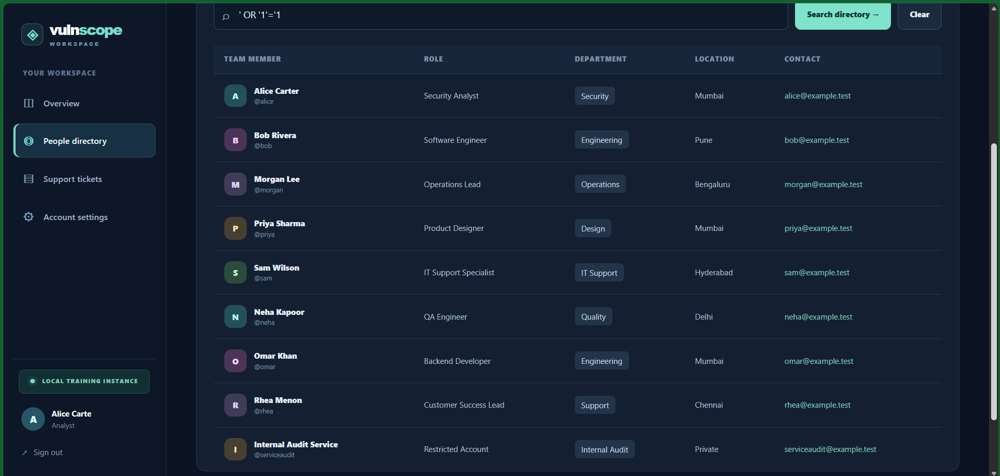
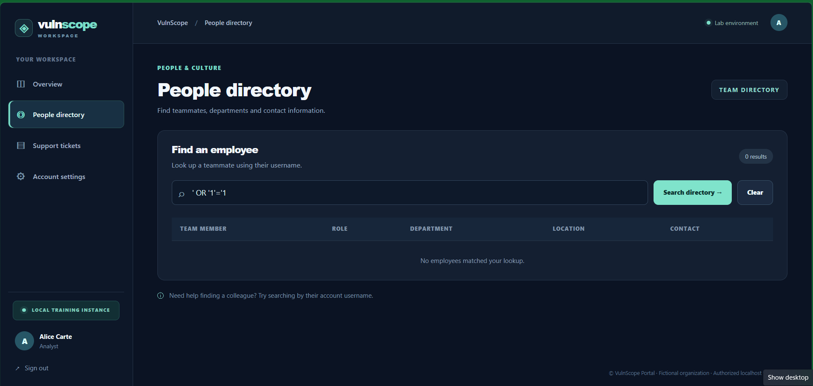
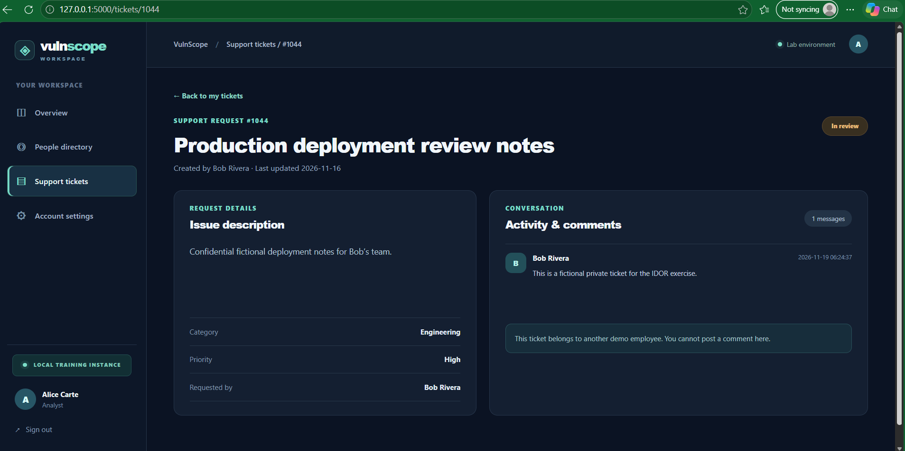
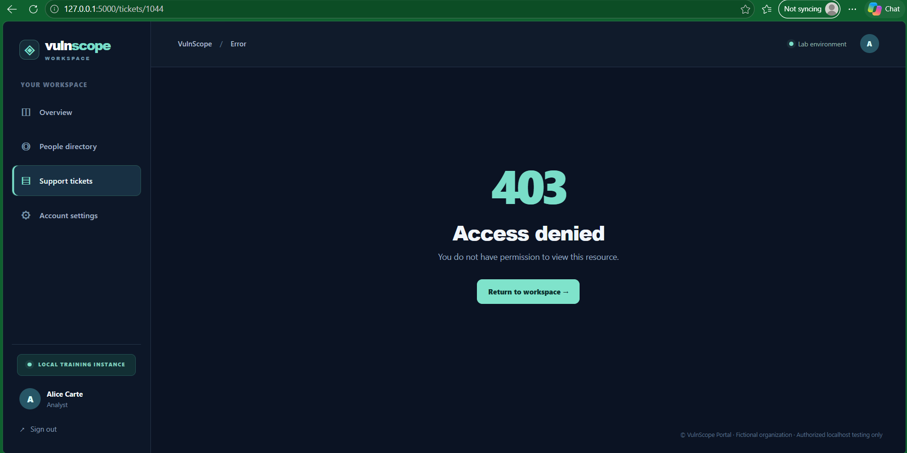
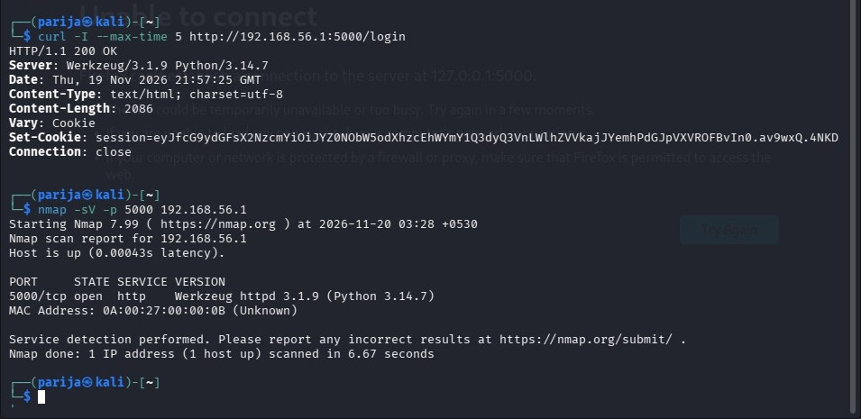
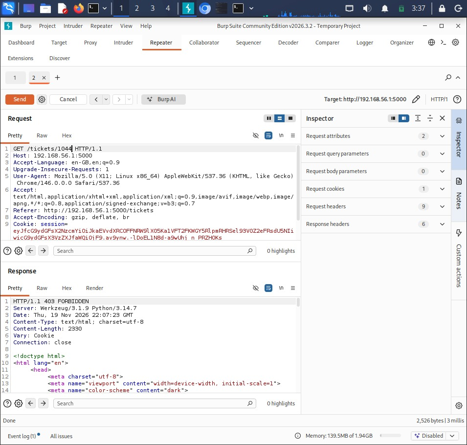
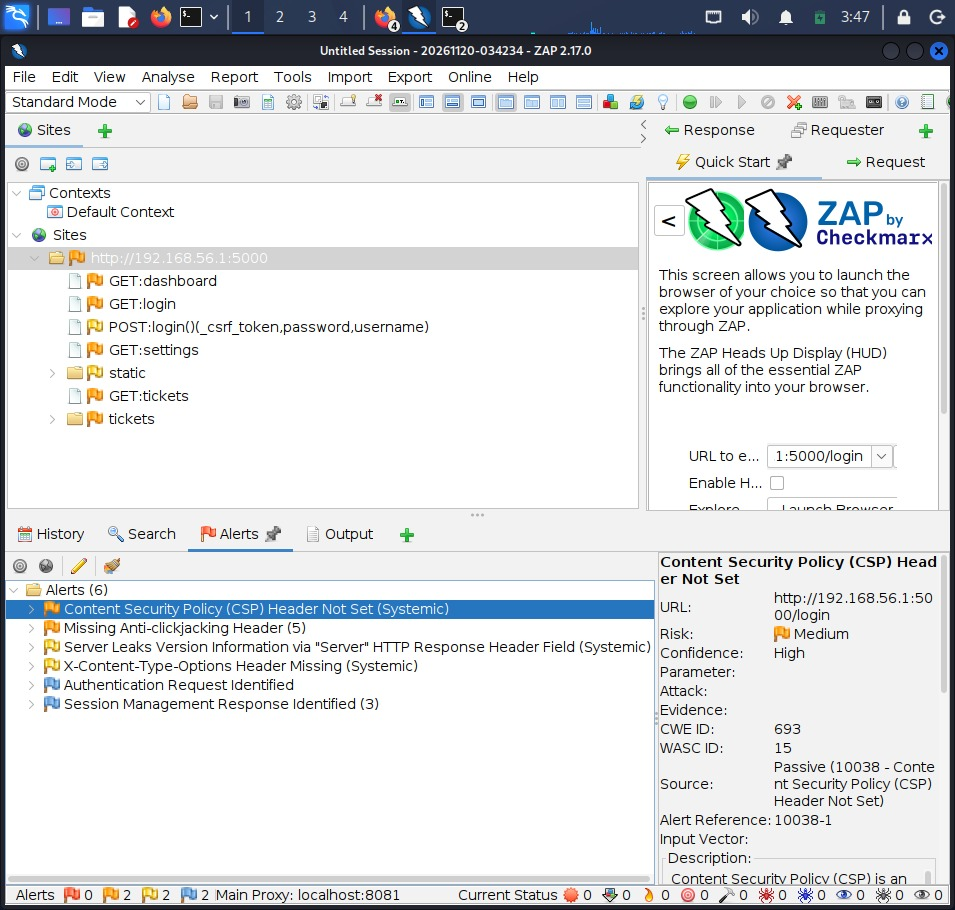
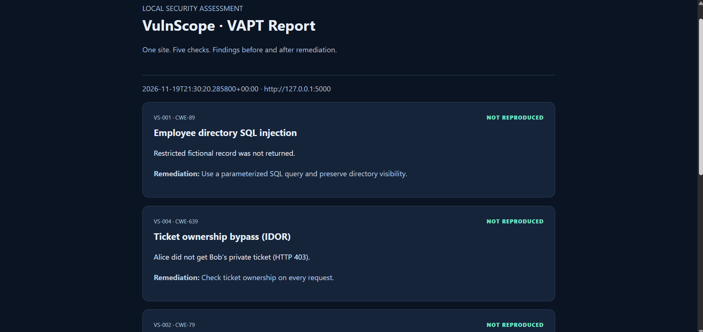

# VulnScope
### Automated Web Application VAPT & Security Assessment

**A hands-on cybersecurity project demonstrating vulnerability assessment, penetration testing, source-code remediation, and security validation on a fictional employee portal.**

VulnScope is a Flask-based web application developed as a controlled environment for learning and demonstrating the complete web application penetration-testing lifecycle.

Instead of testing isolated vulnerability demonstration pages, the assessment focuses on a single functional employee portal with realistic features, including authentication, an employee directory, support tickets, and account settings.

The project covers the process of identifying security weaknesses, reproducing them, implementing fixes, and validating the results using both manual and automated security testing.

> **Security notice:** This is an authorized, self-hosted educational lab using fictional data. It is not intended for public deployment or production use.

---

## Project Overview

The VulnScope workflow consists of four main phases:

1. **Application Exploration** — Browse the employee portal and identify its features and attack surface.
2. **Vulnerability Assessment** — Inspect HTTP requests, test input handling, and evaluate access controls.
3. **Security Remediation** — Implement targeted fixes in the same application's source code.
4. **Verification and Reporting** — Repeat the original tests, review automated results, and document the findings.

## Technology Stack

| Component | Technology |
|---|---|
| Backend | Python, Flask |
| Database | SQLite |
| Frontend | HTML, CSS, Jinja2 |
| Testing environment | Kali Linux, VirtualBox |
| Network scanning | Nmap |
| HTTP security testing | Burp Suite |
| Web security assessment | OWASP ZAP |
| Automated testing | Python assessment scripts |
| Version control | Git and GitHub |

## Application Features

The employee portal provides a realistic environment for testing:

- **Authentication:** Employee login and session management
- **Dashboard:** Employee portal overview
- **Employee Directory:** Search for fictional employee profiles
- **Support Tickets:** View and comment on support requests
- **Account Settings:** Update profile information

Security testing was performed against these existing features, rather than separate vulnerable and secure demonstration pages.

## Vulnerabilities Tested

Five security categories were investigated during the assessment:

| Finding | Vulnerability | Remediation | Post-fix test |
|---|---|---|---|
| VS-001 | SQL Injection | Parameterized SQL queries | Not reproduced |
| VS-002 | Stored Cross-Site Scripting | HTML output escaping | Not reproduced |
| VS-003 | Cross-Site Request Forgery | Session-bound CSRF token validation | Tokenless request rejected |
| VS-004 | Insecure Direct Object Reference | Server-side ownership validation | Unauthorized access blocked |
| VS-005 | Insufficient Login Rate Limiting | Failed-login throttling | HTTP 429 observed |

These results describe the specific test cases performed and do not guarantee that the application is free from all vulnerabilities.

## Before and After Remediation

### SQL Injection — Employee Directory

**Before remediation:** An injection payload caused the directory search to return unintended employee records.



**After remediation:** A parameterized query prevented the original payload from manipulating the SQL statement.



### IDOR — Support Tickets

**Before remediation:** Alice could access another fictional employee's private ticket.



**After remediation:** Server-side authorization blocked unauthorized ticket access.



### Additional Evidence

The complete assessment also contains before-and-after evidence for Stored XSS, CSRF, and authentication rate limiting.

**[Read the full VAPT Assessment Report](docs/VAPT_REPORT.md)**

## Security Tools and Validation

### Nmap

Used for network service discovery against the application running on TCP port 5000 within the isolated VirtualBox lab network.



### Burp Suite

Used to inspect authenticated HTTP traffic and replay requests to validate SQL injection and authorization remediations.



### OWASP ZAP

Used for passive web application security assessment.

ZAP identified additional observations, including missing Content Security Policy and anti-clickjacking headers, an absent `X-Content-Type-Options` header, and server version information disclosure.

These are documented as further hardening opportunities rather than being incorrectly marked as fixed.



### Automated Vulnerability Assessment

The project's automated assessment reported that the five previously tested weaknesses were not reproduced after remediation.



## Project Structure

```text
VulnScope/
├── app/                 # Flask employee portal
├── scanner/             # Automated security assessment
├── tests/               # Application and security tests
├── tools/               # Project utilities
├── docs/
│   ├── VAPT_REPORT.md   # Detailed assessment report
│   └── screenshots/     # Selected evidence
├── reports/             # Local assessment outputs
├── requirements.txt
├── reset_demo.py
├── START_PORTAL_WINDOWS.bat
└── README.md
```

## ## Running the Project

### Requirements

- Windows 10 or 11
- Python 3
- Git (optional, for cloning)

### Installation

**1. Clone the repository**

```powershell
git clone https://github.com/parijagitsss/VulnScope.git
cd VulnScope
```

**2. Start the application**

```powershell
.\START_PORTAL_WINDOWS.bat
```

The startup script automatically creates a Python virtual environment and installs the required dependencies.

**3. Open the employee portal**

Visit:

http://127.0.0.1:5000/login

The application automatically creates its SQLite database and initializes fictional employee accounts, directory records, and support tickets when first launched.

Test accounts are defined in `app/database.py` and are intended only for this local training environment.

**4. Stop the application**

Press `Ctrl + C` in the terminal running Flask.

### Security Notice

VulnScope runs on `127.0.0.1` by default. It is an educational security-testing project and must not be exposed directly to the public internet.
## Assessment Limitations

- Testing was performed in an authorized local laboratory.
- The application uses fictional employee information.
- The initial authentication assessment involved four failed login attempts, not exhaustive password-guessing testing.
- The CSRF proof of concept demonstrated a successful same-site, cross-origin profile modification; it did not establish exploitation from an unrelated external website.
- The demonstrated in-memory login rate limiter is not a production-ready distributed protection mechanism.
- Automated assessment results apply only to the tested cases.
- Additional ZAP security-hardening observations remain for future review.

## Documentation

**[Full VAPT Assessment Report](docs/VAPT_REPORT.md)** — Findings, testing methodology, evidence, remediation steps, retest outcomes, and remaining recommendations.

## Key Learning Outcomes

Through this project, I gained practical experience in:

- Exploring and assessing a functional web application
- Analyzing HTTP requests and responses
- Identifying common OWASP web security weaknesses
- Creating controlled proof-of-concept tests
- Implementing SQL injection, XSS, CSRF, and authorization remediations
- Adding and validating authentication throttling
- Testing with Nmap, Burp Suite, and OWASP ZAP
- Performing post-remediation regression tests
- Preparing a structured penetration-testing assessment report

---

**VulnScope — Learn, Assess, Remediate, Verify.**