# VulnScope — Web Application VAPT Assessment Report

**Project:** VulnScope — Automated Web Application VAPT and Security Assessment

**Assessment type:** Authorized local-lab penetration testing and remediation validation

**Assessment period:** November 2026

**Application:** Fictional Flask-based Employee Portal

**Assessment status:** Five original security weaknesses retested after remediation

---

## 1. Executive Summary

VulnScope is a self-developed web application security assessment project built around a fictional employee portal.

The assessment followed a practical Vulnerability Assessment and Penetration Testing (VAPT) workflow: discovering security weaknesses, reproducing their behavior, implementing source-code remediations, and repeating the original tests to verify the results.

Five security categories were investigated:

- SQL Injection
- Stored Cross-Site Scripting (XSS)
- Cross-Site Request Forgery (CSRF)
- Insecure Direct Object References (IDOR)
- Insufficient Login Rate Limiting

The five original test cases were no longer reproduced during post-remediation automated assessment. Manual testing was also performed to verify the fixes.

Additional security-hardening observations were identified using OWASP ZAP and are documented separately.

**The results demonstrate successful remediation of the tested behaviors, not a guarantee that the entire application is free of vulnerabilities.**

## 2. Scope and Testing Environment

The assessment was conducted against a locally hosted, intentionally vulnerable training application using fictional employee data.

| Component | Technology |
|---|---|
| Application backend | Python, Flask |
| Database | SQLite |
| Frontend | HTML, CSS, Jinja templates |
| Host operating system | Windows |
| Penetration-testing environment | Kali Linux in VirtualBox |
| Web application | Port 5000 |
| Kali testing target | `http://192.168.56.1:5000` |
| Local application access | `http://127.0.0.1:5000` |
| Network | Isolated VirtualBox Host-only network |

All testing was performed against the project owner's local training environment.

## 3. Tools and Methodology

**Manual testing:** Application exploration, browser Developer Tools, HTTP request inspection, controlled payload submission, and authorization testing.

**Nmap:** Network service discovery against the local application port.

**Burp Suite:** HTTP request analysis and Repeater-based validation of access control and SQL injection remediation.

**OWASP ZAP:** Passive security assessment and identification of additional HTTP configuration observations.

**VulnScope scanner:** Automated checks of the five previously identified weaknesses.

The methodology followed four stages:

1. Identify and reproduce the weakness.
2. Preserve the original testing evidence.
3. Implement a targeted remediation in the same application.
4. Retest the original behavior and validate legitimate functionality.

---

## 4. Vulnerability Findings and Remediation

### VS-001 — SQL Injection

**Affected feature:** Employee Directory

**Category:** CWE-89 — Improper Neutralization of Special Elements Used in an SQL Command

**Initial observation:** The directory search constructed SQL statements using unsanitized string interpolation. A controlled injection payload returned unintended employee records.

**Remediation:** Replaced the dynamically constructed query with a parameterized SQLite query using the `?` placeholder.

**Retest:** The original injection payload no longer returned unintended employee records. Legitimate employee searches continued to work.

**Result:** Not reproduced after remediation.

**Evidence:**

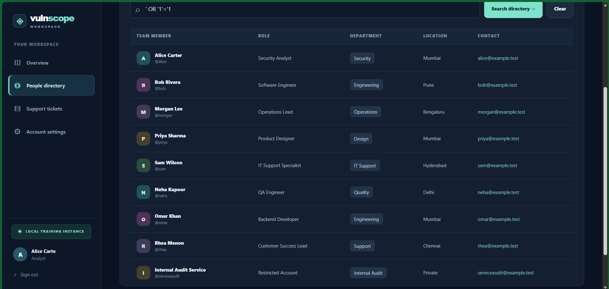

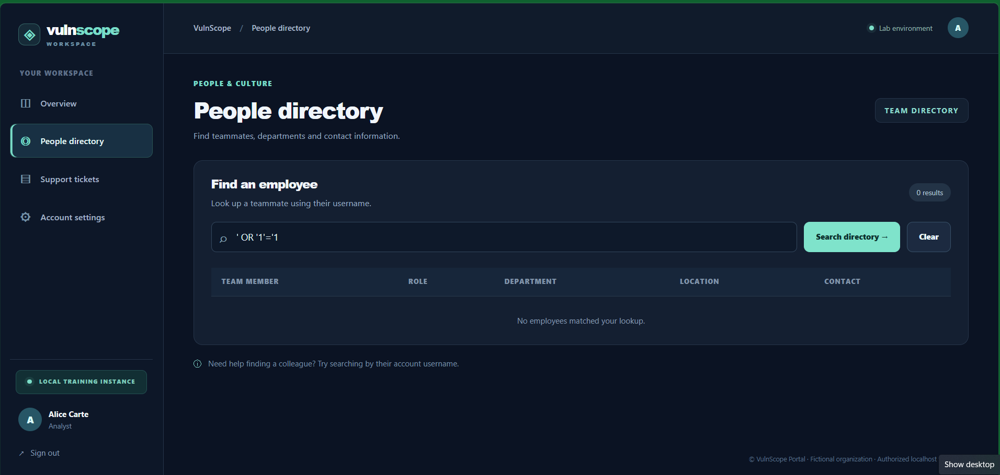

### VS-002 — Stored Cross-Site Scripting

**Affected feature:** Support Ticket Comments

**Category:** CWE-79 — Improper Neutralization of Input During Web Page Generation

**Initial observation:** A submitted ticket comment containing a harmless JavaScript alert payload was rendered as executable markup.

**Remediation:** Removed the Jinja `safe` filter from the user-controlled comment output, allowing normal HTML autoescaping.

**Retest:** The test payload appeared as text rather than executing JavaScript.

**Result:** Not reproduced after remediation.

**Evidence:**

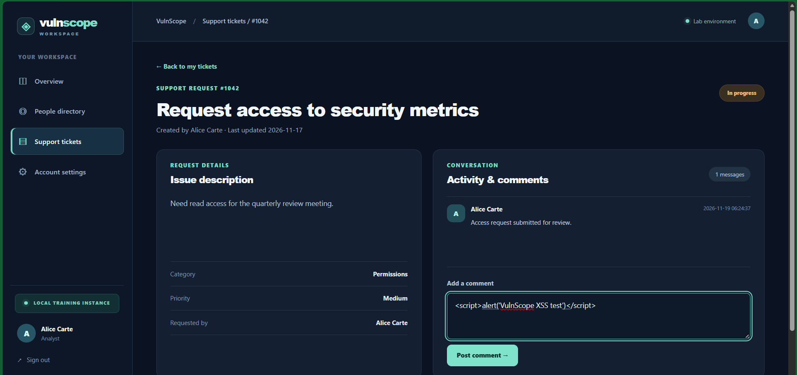

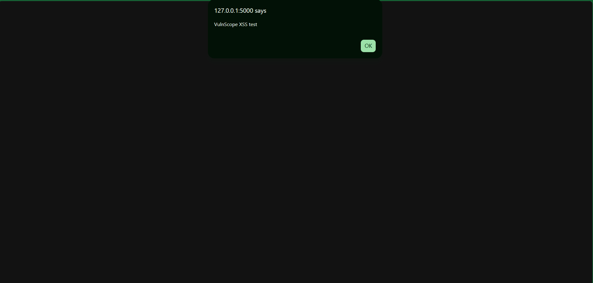

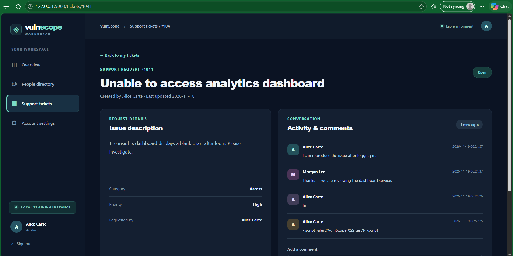

### VS-003 — Cross-Site Request Forgery

**Affected feature:** Account Settings

**Category:** CWE-352 — Cross-Site Request Forgery

**Initial observation:** The account settings endpoint accepted profile updates without requiring a valid CSRF token. A proof-of-concept page served from `127.0.0.1:8000` successfully submitted a profile change to `127.0.0.1:5000`.

**Testing limitation:** These addresses represent different origins on the same site. The successful test does not, by itself, demonstrate exploitation from an unrelated external website.

**Remediation:** Added a session-bound CSRF token to the settings form and server-side token validation for profile updates.

**Retest:** A request without the required token was rejected with HTTP 403. Legitimate settings updates continued to work.

**Result:** Tested tokenless request rejected after remediation.

**Evidence:**

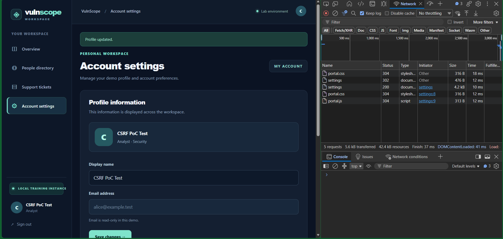

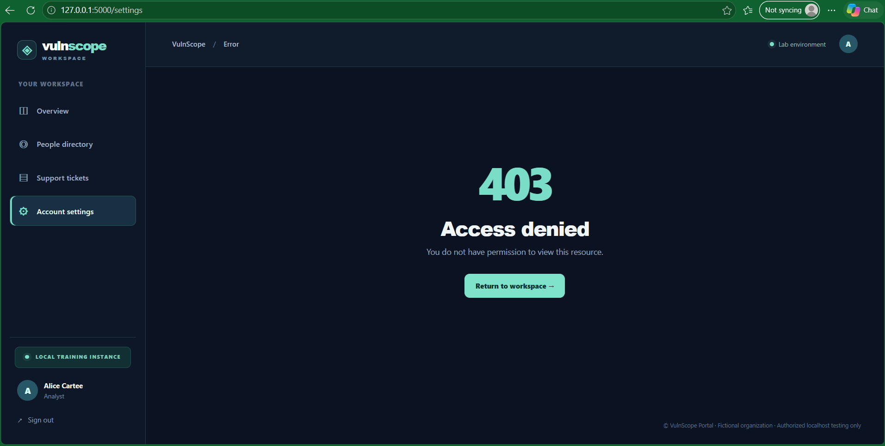

### VS-004 — Insecure Direct Object Reference

**Affected feature:** Support Ticket Details

**Category:** CWE-639 — Authorization Bypass Through User-Controlled Key

**Initial observation:** Alice could access Bob's private support ticket by navigating to the ticket's identifier, despite not owning the ticket.

**Remediation:** Added server-side authorization to verify that the currently authenticated user's ID matched the requested ticket's owner ID.

**Retest:** Alice could access her own ticket, while access to Bob's ticket returned HTTP 403 Forbidden.

**Result:** Unauthorized access blocked after remediation.

**Evidence:**

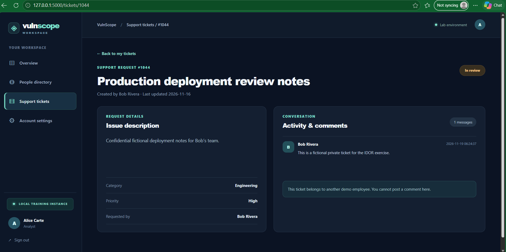

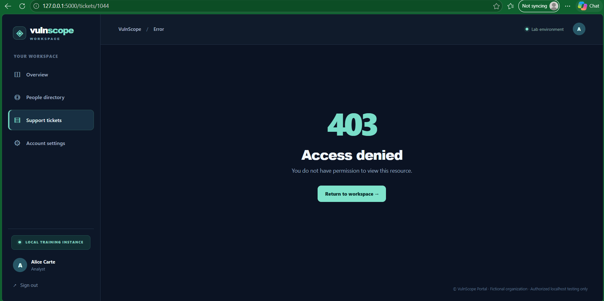

### VS-005 — Insufficient Login Rate Limiting

**Affected feature:** Authentication

**Category:** CWE-307 — Improper Restriction of Excessive Authentication Attempts

**Initial observation:** Four consecutive invalid login attempts returned HTTP 401, without a rate-limiting response during the tested sequence.

**Testing limitation:** Four requests alone do not establish the absence of every possible authentication protection.

**Remediation:** Implemented server-side failed-attempt tracking and temporary login throttling for the laboratory application.

**Retest:** Three failed attempts returned HTTP 401. The fourth attempt returned HTTP 429 Too Many Requests under the configured test threshold.

**Result:** Configured rate limiting verified after remediation.

**Implementation limitation:** The current in-memory counter is appropriate for this local demonstration but would require a shared, persistent approach for a production deployment.

**Evidence:**

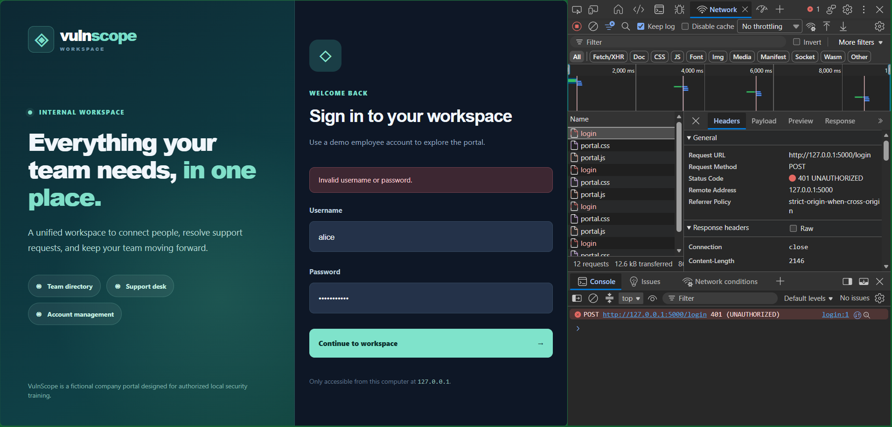

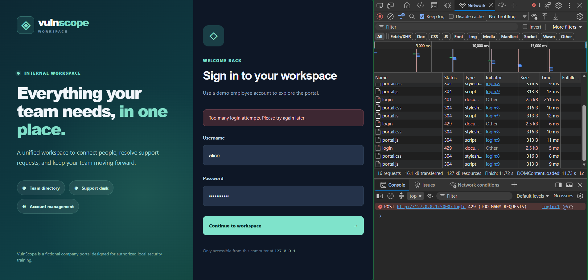

---

## 5. Security Tool Validation

### Nmap

Nmap was used for service discovery against the Windows-hosted application over the VirtualBox Host-only network.

**Target:** `192.168.56.1`

**Port assessed:** TCP 5000

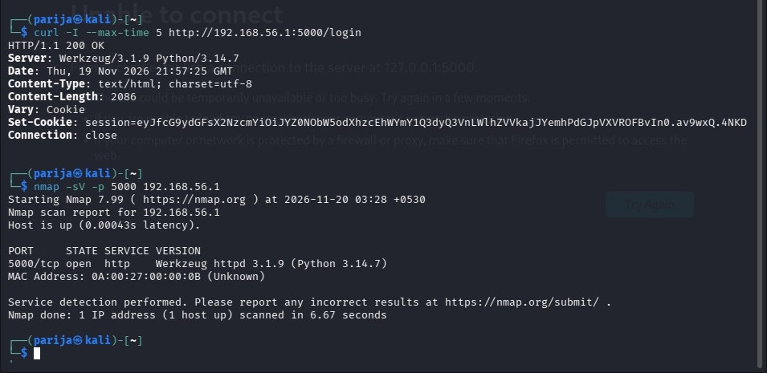

### Burp Suite

Burp Suite was used to inspect and replay authenticated HTTP requests against the remediated portal.

Testing included verification that unauthorized ticket access was blocked and SQL injection no longer manipulated directory search results.

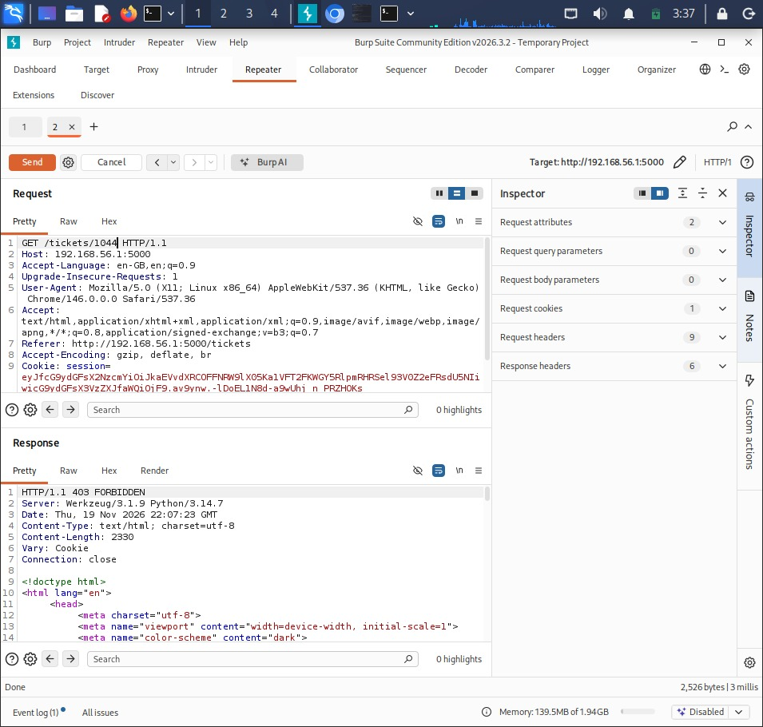

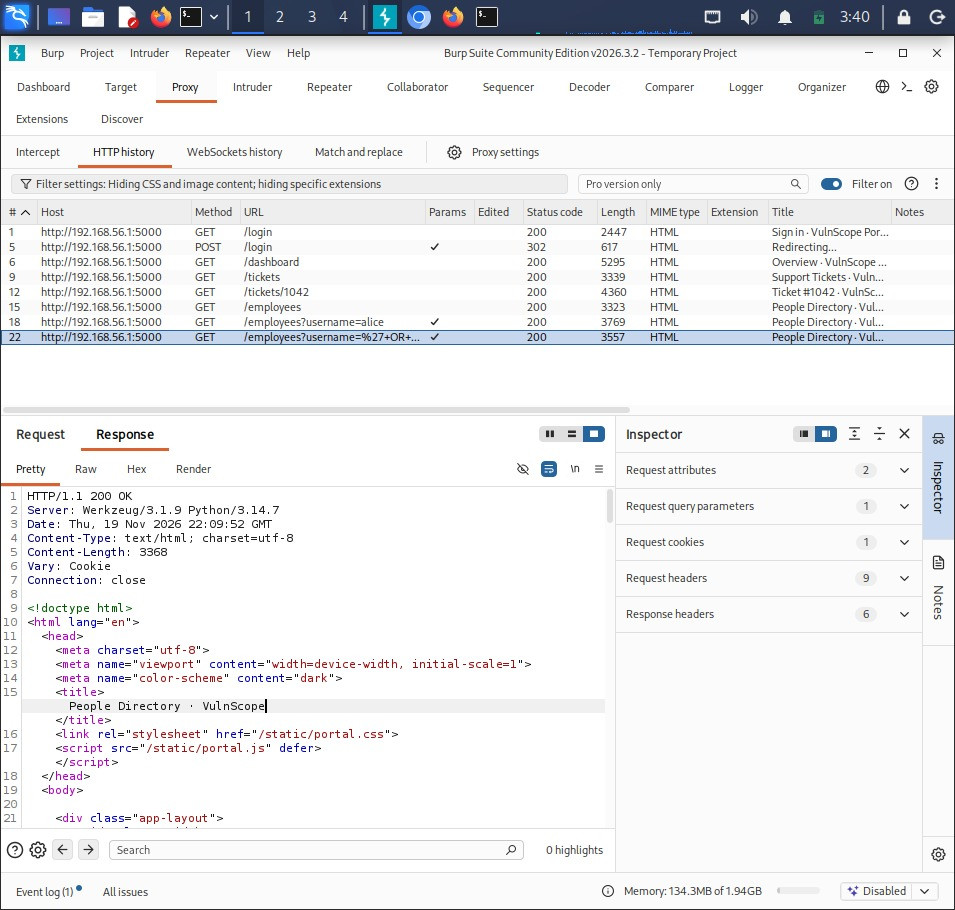

### Automated Assessment

The project's automated scanner reported that the five original security weaknesses were not reproduced after remediation.

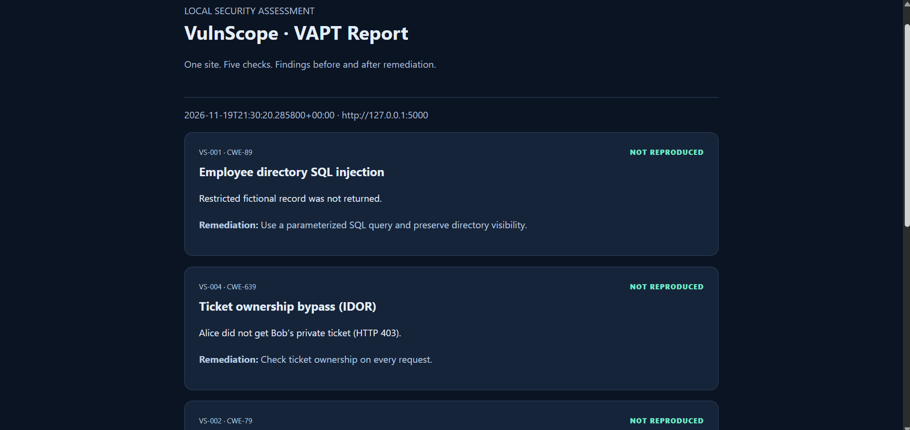

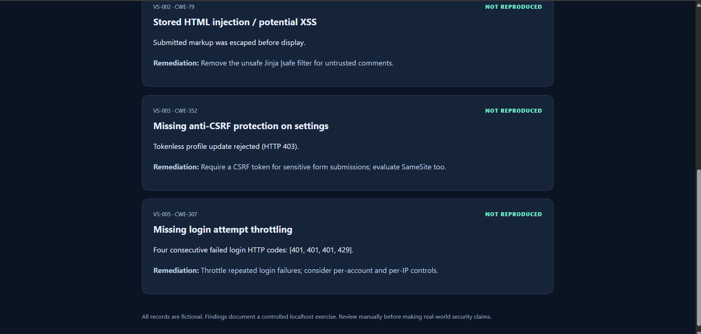

### OWASP ZAP

OWASP ZAP was used for passive assessment of the remediated application.

The assessment identified additional observations, including:

| Alert | Classification |
|---|---|
| Content Security Policy (CSP) Header Not Set | Medium |
| Missing Anti-clickjacking Header | Medium |
| Server Version Information Disclosure | Low |
| X-Content-Type-Options Header Missing | Low |
| Authentication Request Identified | Informational |
| Session Management Response Identified | Informational |

The informational observations are not automatically security vulnerabilities.

The missing HTTP security headers and server information disclosure should be reviewed as